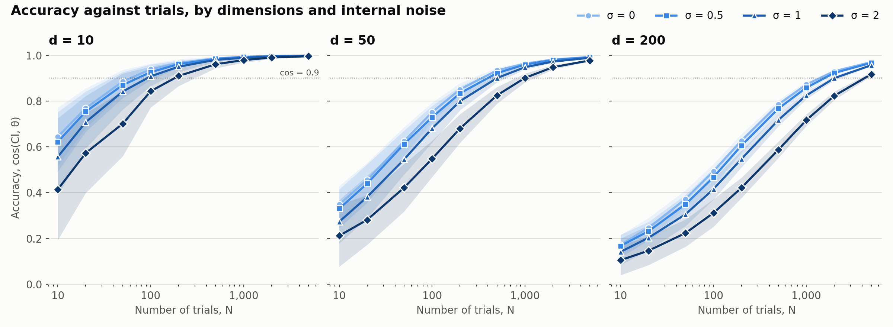

# Stage 0 report: recovering a simulated person's template

**Log date:** 2026-11-18

**Model:** a linear observer with a hidden unit template θ does a 2IFC task on ±n noise pairs. The classification image is CI = Σ s·n, and accuracy is cos(CI, θ). Details are in the [model notes](../model/01-simulated-person-on-paper.md), and the code is in the [notebook](../notebooks/01-simulated-person.ipynb).

## Figure

*Each point is the mean over 200 simulated persons, and the band is ± 1 SD across persons. σ is the SD of the noise on each image's score. The dotted line marks cos = 0.9. Data: [accuracy-vs-trials.csv](data/accuracy-vs-trials.csv).*

## Log entry

### What I expected

Before running the code, I predicted from cos ≈ 1 / √(1 + (d − 1) / (N·a²)), with a² = (2/π) / (1 + σ²/2):

1. Accuracy rises quickly with trials, then flattens toward 1.
2. Trials needed for a fixed accuracy grow in proportion to 1 + σ²/2, so σ = 2 costs 3× as many as σ = 0.
3. Trials needed grow in proportion to d − 1, so going from d = 10 to d = 200 costs about 22×.

### What I saw

All three predictions held.

| Trials needed for cos = 0.9 | σ = 0 | σ = 0.5 | σ = 1 | σ = 2 | Cost of σ = 2 vs. σ = 0 |
|---|---|---|---|---|---|
| **d = 10** | 61 | 73 | 92 | 181 | 3.0× |
| **d = 50** | 344 | 398 | 499 | 991 | 2.9× |
| **d = 200** | 1,395 | 1,567 | 2,002 | 4,235 | 3.0× |
| **Cost of d = 200 vs. d = 10** | 22.9× | 21.5× | 21.8× | 23.4× | |

- Measured trial counts are within 8% of the formula. They are read off by interpolating between tested values of N, which pushes them slightly high.
- Dimensions cost far more than internal noise over these ranges: about 22× for d = 10 → 200, against 3× for σ = 0 → 2.
- One person's result is unreliable when trials are few. At d = 10 and σ = 1, the SD across persons is 0.042 at N = 100 and 0.006 at N = 1,000.

### One surprise

**Passing the signal test says almost nothing about how accurate a CI is.** I expected the CIs that passed the random-responder test (z > 1.96) to be clearly closer to θ than those that failed. They were barely closer:

| N (d = 10, σ = 1; 2,000 persons) | Share detected | Mean cos, detected | Mean cos, not detected |
|---|---|---|---|
| 10 | 12.9% | 0.571 | 0.563 |
| 20 | 39.3% | 0.699 | 0.686 |
| 50 | 93.3% | 0.836 | 0.819 |

At N = 20, 61% of real observers fail the test, yet their CIs average cos = 0.686. The test looks only at the CI's length, while accuracy depends on its direction. That is my likely explanation, and I have not tested it. For now, I read a failed test at small N as "not enough evidence of signal", not as "this CI is poor".

### Limits and next step

- The observer is idealised: linear, with a fixed template and no response bias.
- The tested dimensions stop at d = 200, far below the 4,092 parameters of sinusoidal noise.
- The test follows my recollection of infoVal, so its formula still needs checking against Brinkman et al. (2019).
- **Next:** test why length and direction come apart, and repeat the comparison at larger d.
